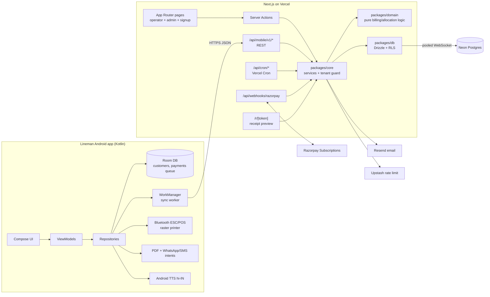
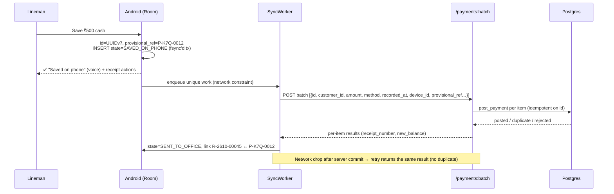

# Implementation Plan — Cable Operator Billing Platform

| | |
|---|---|
| **Status** | v0.1 draft for review |
| **Date** | 2026-10-12 |
| **Source of truth** | [`docs/BRD.md`](./BRD.md) (business rules) and [`docs/PRD.md`](./PRD.md) (product requirements). Where this plan and the BRD/PRD disagree, the BRD/PRD win unless the [Decisions log](#1-decisions-log) records an explicit, dated change. |
| **Scope** | MVP plus migration and cutover, as defined in PRD §5 and BRD §6.1 |

IDs referenced throughout: `B-xxx` and `RULE-xx` (BRD), `FR-xxx`, `BR-xx` and `J-xx` (PRD), `D-xx` (decisions below).

---

## Table of contents

1. [Decisions log](#1-decisions-log)
2. [Users and UX principles](#2-users-and-ux-principles)
3. [Architecture overview](#3-architecture-overview)
4. [Tech stack](#4-tech-stack)
5. [Monorepo layout](#5-monorepo-layout)
6. [Design system — single source of truth](#6-design-system--single-source-of-truth)
7. [Data model](#7-data-model)
8. [Billing, payments and ledger rules (exact algorithms)](#8-billing-payments-and-ledger-rules-exact-algorithms)
9. [Security, tenancy and access control](#9-security-tenancy-and-access-control)
10. [APIs and offline sync protocol](#10-apis-and-offline-sync-protocol)
11. [Android lineman app](#11-android-lineman-app)
12. [Web app (operator dashboard, sign-up, admin)](#12-web-app-operator-dashboard-sign-up-admin)
13. [SaaS subscription (Razorpay)](#13-saas-subscription-razorpay)
14. [Background jobs](#14-background-jobs)
15. [Legacy migration](#15-legacy-migration)
16. [Testing strategy and acceptance matrix](#16-testing-strategy-and-acceptance-matrix)
17. [Environments, CI/CD, observability and backups](#17-environments-cicd-observability-and-backups)
18. [Delivery phases](#18-delivery-phases)
19. [Risks](#19-risks)
20. [Remaining open questions](#20-remaining-open-questions)

---

## 1. Decisions log

### 1.1 Confirmed by the product owner (2026-10-12)

| ID | Decision | Notes / impact |
|---|---|---|
| D-01 | **Monorepo.** A Next.js app serves both the web frontend and the backend, hosted on **Vercel**. | Same codebase for UI, server actions, the mobile REST API and cron jobs. |
| D-02 | **Database: Postgres on Neon.** | Drizzle ORM. Neon branches back preview environments. |
| D-03 | **Lineman app: native Android in Kotlin.** | Jetpack Compose. Offline-first with Room and WorkManager. |
| D-04 | **Hyper-minimalist UI.** Colours, typography, borders, spacing and radius are all configurable from **one file**. Tailwind CSS v4 (latest). | One token file generates both the Tailwind v4 `@theme` CSS and the Kotlin Compose tokens. See §6. |
| D-05 | **Users have low literacy.** Linemen: illiterate or nearly literate. Operators: mid-literate. | Drives every UX choice in §2, §11 and §12. |
| D-06 | **Languages: Hindi + English.** Hindi is the default on Android and English the default on web. Users can switch. | All strings live in translation files from day one. |
| D-07 | **Lineman sign-in: username + password.** | Mitigated for low literacy: sign in once per phone, long-lived sessions, "show password" on by default, tap-to-call the office for resets (§11.6). |
| D-08 | **Devices: Android 8.0+ (minSdk 26). Printers: generic 58 mm Bluetooth ESC/POS thermal.** | Receipts are printed as **raster bitmaps**, so Hindi text prints on printers that have no Devanagari font (§11.8). |
| D-09 | **Legacy dump is available. Migration is built after the core** (PRD Phase 4 order). | The dump **never goes in git** because it contains customer personal data. |
| D-10 | **Lineman UX aids:** icons + fixed colour meanings everywhere, **voice read-out (Android TTS)**, **number-pad-first search**. | §11.3 |
| D-11 | **Lineman home is search only.** There is no area browsing and no assigned list. Any customer of the operator can be collected from (B-012). | The search keypad is the home screen. |
| D-12 | **Operator subscription fee is collected online through Razorpay.** | This is *our* SaaS fee only. Cable-customer payments stay cash/UPI recorded, with no gateway (BRD §6.2). §13 |
| D-13 | **After grace expires the tenant goes read-only, but collections are still allowed.** | Linemen can still sync payments and submit handovers. Billing runs pause. |
| D-14 | **All BRD/PRD recommended baselines are accepted:** suspension stops rent from the next month; a plan change after the bill is issued becomes an adjustment; credit auto-applies oldest-first; invoice numbers run per tenant; receipt links expire after 90 days and can be revoked. | Closes BRD §16 and PRD §18 rows for suspension, plan change, credit, numbering and link expiry. |
| D-15 | **Self sign-up with a free trial** (this replaces PRD J-01 "platform admin creates tenant"). The admin can still create tenants, for example for migrated legacy operators. | Needs a public sign-up page, email verification and abuse protection. |
| D-16 | **Three fixed roles: Owner, Staff, Lineman.** There are no permission toggles. A separate Platform Admin role exists outside tenants. | Matrix in §9.3. |
| D-17 | **Whole rupees in the UI.** The database stores integer **paise** (`bigint`). | Paise can be enabled later without a schema change. |
| D-18 | **Mid-month new connection or reactivation: each operator chooses** between "charge full month (as adjustment)" and "start from next month". | Operator setting `mid_month_start_policy`. §8.3 |
| D-19 | **Distribution: Google Play** (closed-testing track for the pilot, then production). | Needs a Play developer account, privacy policy, data-safety form and an in-app minimum-version gate. |
| D-20 | **Subscription: 30-day trial, 15-day grace.** | §13 |
| D-21 | **Product name: "Cable Billing".** The domain is not decided yet. | Until the domain is chosen, the Android `applicationId` is `com.cablebilling.lineman` and email uses a placeholder sender. Both must be final before the first Play production release (H-02). |
| D-22 | **Subscription price: ₹400/month + GST** (18% → ₹472 charged). | Razorpay plan amount includes GST. Tax invoices for our fee need the business GSTIN (H-10). |
| D-23 | **The product owner reviews all Hindi copy.** | Task H-03. |
| D-24 | **Device testing:** the product owner will plan a broad phone/printer test matrix later. | Task H-05. Engineering keeps minSdk 26 and the raster-print approach. |
| D-25 | **Missed bill runs (after read-only) are never generated automatically.** The Owner previews and runs them manually. | §13, closes Q-03. |

### 1.2 Engineering defaults (proposed — say if you disagree)

| ID | Default | Why |
|---|---|---|
| E-01 | pnpm workspaces + Turborepo. The Android Gradle project lives in `apps/android` (outside the pnpm graph). | Standard and well-supported on Vercel. |
| E-02 | **Drizzle ORM** + drizzle-kit SQL migrations. Driver: `@neondatabase/serverless` **Pool** (WebSocket). | Billing and payment posting need interactive transactions and `SELECT … FOR UPDATE`, which the HTTP driver can't do. |
| E-03 | **Postgres Row-Level Security** as a second line of defence behind the app-level tenant scope. | FR-001: a tenant-scoping bug is the top business risk. |
| E-04 | Auth: **Better Auth** (Drizzle adapter, username plugin, bearer tokens for Android), with **argon2id** password hashing. | Gives sessions, rate limits, email verification and password reset off the shelf. Android uses short-lived access tokens plus revocable refresh tokens per device. |
| E-05 | Shared **Zod** schemas generate an **OpenAPI 3.1** spec, which generates Kotlin DTOs. | One contract for web and Android. |
| E-06 | Vercel **Pro** plan, Fluid compute, Node.js runtime (not Edge) for anything that touches the DB. Functions are co-located with the Neon region. | Commercial use requires Pro anyway. Pro is also needed for frequent crons and longer function durations. |
| E-07 | Email: **Resend**. Bot protection on sign-up: **Cloudflare Turnstile**. Rate limiting: **Upstash Redis** (Vercel Marketplace). | Small, managed, serverless-friendly. |
| E-08 | Error monitoring: **Sentry** on web and Android. Logs go to Vercel Observability or a log drain. | PRD §11 observability. |
| E-09 | Web components: **shadcn/ui** (Radix primitives) copied into `packages/ui` and restyled with tokens only. Icons: **Lucide** on web; the *same* Lucide SVGs are converted to Compose `ImageVector`s for Android. | Accessible primitives and identical icon meanings on both platforms. |
| E-10 | Lint/format: **Biome** for TypeScript, **ktlint + detekt** for Kotlin. Tests: **Vitest**, **Playwright** and **fast-check** (TS); **JUnit5, Turbine, Robolectric** and **Compose UI tests** (Android). | |
| E-11 | Node.js 24 LTS. TypeScript strict. | |

---

## 2. Users and UX principles

### 2.1 Personas

| Persona | Literacy / context | Surface | Primary jobs |
|---|---|---|---|
| **Lineman** | Illiterate or nearly literate. Reads numbers well, reads words poorly. Uses a budget Android phone outdoors in sunlight with patchy network. | Android app | Find customer, see due, take cash/UPI, give receipt, hand over cash at day end. |
| **Operator owner** | Mid-literacy. Uses WhatsApp and YouTube comfortably. Has little or no spreadsheet experience. Uses a phone or an old laptop. | Web (responsive, works on phone) | Set prices, add customers and connections, check who owes money, check linemen's cash, see the monthly bill run. |
| **Office staff** | Mid-literacy. Works at the counter. | Web | Add or edit customers, take counter payments, check handovers. |
| **Platform admin** (us) | Technical. | Web `/admin` | Tenants, subscriptions, support, job health. |

### 2.2 UX rules for every screen

These rules are design acceptance criteria. Every screen is reviewed against them before merge.

1. **One screen = one job.** Each screen has one primary button, placed where the thumb reaches (bottom on mobile).
2. **Numbers first, words second.** Amounts are the largest thing on the screen. Use Indian grouping: `₹1,23,456`.
3. **Every action is icon + colour + a short word.** Never text alone, and never colour alone.
4. **Fixed colour meanings**, identical on web and Android (defined once in tokens, §6):

   | Meaning | Colour token | Icon |
   |---|---|---|
   | Cash | `semantic.cash` (green) | banknote |
   | UPI | `semantic.upi` (blue) | qr-code |
   | Saved on phone / waiting | `semantic.pending` (amber) | clock |
   | Done / sent to office | `semantic.success` (green) | check-circle |
   | Problem / needs office | `semantic.danger` (red) | alert-triangle |
   | Money due | `semantic.due` (red text only) | — |
   | Credit (customer paid extra) | `semantic.credit` (green text only) | — |

5. **Plain words, no jargon.** For example, "बिल / Bill" instead of "Invoice", and "फ़ोन में सेव / Saved on phone" instead of "Pending sync". A glossary file in `packages/i18n` keeps terms consistent.
6. **Nothing destructive within reach.** Linemen cannot delete or edit payments. Only owners can reverse, and reversal is a guided flow with a reason.
7. **Confirm before money moves.** Show a summary screen (read aloud on Android), then Save.
8. **Show state honestly** (BR-11, BR-12). Show "WhatsApp opened", never "Sent". Show "Saved on phone", never "Paid", until the server confirms.
9. **Large and high contrast.** Android: body text at least 18sp, amounts at least 40sp, touch targets at least 56dp (primary buttons 64dp). Web: body at least 16px, controls at least 44px.
10. **Bilingual everywhere.** The language switch is always one tap away. Dates use `12 Oct 2026` / `12 अक्टू 2026`.
11. **Field-test before sign-off.** Phase 3 includes moderated sessions with at least 5 real linemen and 3 operators (task success, time on task, errors). Results feed into design-token and copy changes.

---

## 3. Architecture overview



**Key principles**

- **One backend, two clients.** Server Actions (web) and REST route handlers (Android) are thin adapters over the same `packages/core` services. Business logic never lives in route files.
- **Pure domain core.** Billing eligibility, invoice calculation and payment allocation are pure functions in `packages/domain` with no I/O. They are property-tested and are the single implementation of BR-05 to BR-09.
- **Every write is a transaction with a tenant context.** `withTenant(ctx, tx => …)` sets `app.operator_id` for RLS and passes a tenant-scoped repository.
- **Append-only financials.** Posted payments, issued invoices, allocations and ledger entries are never updated or deleted. Corrections are new linked rows (RULE-20, BR-13). DB triggers enforce this.
- **Offline-first mobile.** Room is the source of truth for the UI on the phone. The server is the source of truth for posted money.

---

## 4. Tech stack

| Layer | Choice |
|---|---|
| Web framework | Next.js (latest stable, App Router, React Server Components, Server Actions), TypeScript strict |
| Styling | Tailwind CSS **v4** (CSS-first `@theme`), driven by generated tokens |
| UI primitives | shadcn/ui (Radix) restyled; Lucide icons |
| i18n (web) | `next-intl` with `en` and `hi` catalogues |
| Validation / contracts | Zod → OpenAPI 3.1 (`zod-openapi`) |
| DB / ORM | Neon Postgres 17 + Drizzle ORM + drizzle-kit |
| Auth | Better Auth + argon2id; Turnstile on sign-up |
| Email | Resend (verification, password reset, billing-run alerts) |
| Rate limiting | Upstash Redis |
| PDF (web) | `@react-pdf/renderer` for A4/A5 counter receipts and statements |
| Jobs | Vercel Cron + a DB-backed job table (`FOR UPDATE SKIP LOCKED`) |
| Subscription payments | Razorpay Subscriptions API + webhooks |
| Android | Kotlin 2.x, Jetpack Compose (Material 3 heavily themed), Hilt, Room, WorkManager, Retrofit + OkHttp + kotlinx.serialization, DataStore + Tink/Keystore, Navigation Compose, Coroutines/Flow |
| Android printing | Bluetooth Classic SPP, ESC/POS raster (`GS v 0`), 384 px width for 58 mm |
| Android PDF | `android.graphics.pdf.PdfDocument` (works offline) |
| Monitoring | Sentry (web + Android), Vercel Observability, uptime check on `/api/health` |
| CI/CD | GitHub Actions, Vercel Git integration, Neon branch per PR, Gradle Play Publisher |

---

## 5. Monorepo layout

```text
cable-billing-v2/
├── apps/
│   ├── web/                         # Next.js (frontend + backend), deployed to Vercel
│   │   ├── src/app/
│   │   │   ├── (marketing)/         # landing, pricing, privacy policy, terms
│   │   │   ├── (auth)/              # sign-up, login, verify email, reset password
│   │   │   ├── (operator)/          # tenant dashboard (owner + staff)
│   │   │   │   ├── home/ customers/ payments/ linemen/ bills/ reports/ settings/
│   │   │   ├── admin/               # platform admin console
│   │   │   ├── r/[token]/           # public receipt preview (tokenised)
│   │   │   └── api/
│   │   │       ├── mobile/v1/       # REST for Android
│   │   │       ├── cron/            # Vercel Cron entry points (secret-protected)
│   │   │       ├── webhooks/razorpay/
│   │   │       └── health/
│   │   ├── src/components/          # app-specific composites
│   │   ├── messages/{en,hi}.json    # generated from packages/i18n
│   │   └── vercel.json              # crons, regions
│   └── android/                     # Gradle project (Kotlin)
│       ├── app/                     # single app module, feature packages
│       ├── core/designsystem/       # GENERATED tokens + Compose theme + icons
│       └── gradle/libs.versions.toml
├── packages/
│   ├── design-tokens/               # ★ tokens.json — the ONE place for colours, type, radius, borders, spacing
│   │   ├── tokens.json
│   │   ├── icons.json               # semantic icon name → Lucide icon
│   │   └── scripts/build.ts         # emits web CSS + Kotlin + Android vectors
│   ├── ui/                          # React components (shadcn-based), theme.css (generated)
│   ├── i18n/                        # en.json / hi.json source + glossary; emits web messages + Android strings.xml
│   ├── domain/                      # pure TS: money, periods, eligibility, invoice calc, allocation (no I/O)
│   ├── db/                          # Drizzle schema, migrations, RLS policies, seed
│   ├── core/                        # services, tenant guard, authz, audit, jobs
│   ├── contracts/                   # Zod schemas for mobile API → openapi.json
│   └── config/                      # shared tsconfig, biome config
├── tools/
│   └── migration/                   # legacy MariaDB → Neon import, reconciliation reports
├── docs/
│   ├── BRD.md  PRD.md  *.rtf        # source of truth
│   ├── IMPLEMENTATION_PLAN.md       # this file
│   └── adr/                         # architecture decision records as we go
├── .github/workflows/               # web.yml, android.yml, tokens-check.yml, backup.yml
├── turbo.json  pnpm-workspace.yaml  package.json  biome.json
└── README.md
```

**Generated files are committed.** CI fails if regenerating them produces a diff. This lets the Android build run without Node and keeps PR diffs reviewable. Generated files: `packages/ui/src/theme.css`, `apps/android/core/designsystem/.../Tokens.kt`, Android icon vectors, `strings.xml`, `openapi.json`.

---

## 6. Design system — single source of truth

### 6.1 The one file: `packages/design-tokens/tokens.json`

Edit this file, run `pnpm tokens:build`, and both apps change. Nothing in `apps/` may hard-code a colour, font size, radius, border width or spacing value. Biome and detekt rules flag raw hex values and `dp` literals outside the generated module.

```jsonc
{
  "color": {
    "bg":          { "value": "#FFFFFF" },
    "surface":     { "value": "#FAFAFA" },
    "text":        { "value": "#111111" },
    "textMuted":   { "value": "#6B6B6B" },
    "border":      { "value": "#E5E5E5" },
    "accent":      { "value": "#111111" },   // hyper-minimal: black is the brand; change here for a colour accent
    "onAccent":    { "value": "#FFFFFF" },
    "focus":       { "value": "#2563EB" }
  },
  "semantic": {
    "cash":    { "value": "#15803D" },
    "upi":     { "value": "#1D4ED8" },
    "pending": { "value": "#B45309" },
    "success": { "value": "#15803D" },
    "danger":  { "value": "#B91C1C" },
    "due":     { "value": "#B91C1C" },
    "credit":  { "value": "#15803D" }
  },
  "font": {
    "family": {
      "sans": { "value": ["Inter", "Noto Sans Devanagari", "system-ui", "sans-serif"] },
      "numeric": { "value": ["Inter", "system-ui"], "features": ["tnum"] }
    },
    "weight": { "regular": { "value": 400 }, "strong": { "value": 600 } }
  },
  "type": {                                  // per-platform scales, one file
    "web":     { "sm": 14, "base": 16, "lg": 18, "xl": 22, "2xl": 28, "amount": 36 },
    "android": { "sm": 16, "base": 18, "lg": 22, "xl": 26, "2xl": 32, "amount": 44 }
  },
  "radius":  { "none": 0, "sm": 4, "md": 8, "lg": 12, "full": 9999 },
  "border":  { "hairline": 1, "strong": 2 },
  "space":   { "base": 4 },                  // all spacing = multiples of base
  "size":    { "touchMin": { "web": 44, "android": 56 }, "primaryButton": { "web": 48, "android": 64 } },
  "elevation": { "none": 0 }                 // hyper-minimal: no shadows
}
```

### 6.2 Generated outputs

**Web: `packages/ui/src/theme.css` (Tailwind v4, CSS-first).** The default palette is reset so that *only* tokens exist as utilities:

```css
@import "tailwindcss";

@theme {
  --color-*: initial;               /* remove Tailwind's default palette: tokens only */
  --color-bg: #FFFFFF;
  --color-text: #111111;
  --color-cash: #15803D;
  /* … */
  --font-sans: Inter, "Noto Sans Devanagari", system-ui, sans-serif;
  --text-base: 1rem;
  --text-amount: 2.25rem;
  --radius-md: 0.5rem;
  --spacing: 0.25rem;
  --shadow-*: initial;              /* no shadows */
}

/* Tailwind v4 has no border-width theme namespace, so we expose tokens as utilities */
@utility border-hairline { border-width: 1px; }
@utility border-strong   { border-width: 2px; }
```

Usage: `bg-bg text-text border-hairline border-border rounded-md text-amount text-cash`.

**Android: `core/designsystem/Tokens.kt`**, plus a `CableTheme {}` that maps the tokens onto `MaterialTheme` (colours, shapes, typography) and exposes `LocalSemanticColors` for cash, UPI, pending and so on.

```kotlin
// GENERATED — edit packages/design-tokens/tokens.json instead
object Tokens {
    object Color { val Bg = Color(0xFFFFFFFF); val Text = Color(0xFF111111); val Cash = Color(0xFF15803D) /* … */ }
    object Radius { val Md = 8.dp }
    object Border { val Hairline = 1.dp; val Strong = 2.dp }
    object Type { val Base = 18.sp; val Amount = 44.sp }
    object Size { val TouchMin = 56.dp; val PrimaryButton = 64.dp }
}
```

**Icons: `icons.json`** maps semantic names (`cash`, `upi`, `pending`, `print`, `whatsapp`, `sms`, `search`, `handover`, …) to Lucide icon names. The build emits a React icon map and Android `ImageVector`s, so both platforms use the same glyph for the same meaning.

### 6.3 Hyper-minimal rules (enforced in review)

- White background, near-black text, a single accent colour. Semantic colours appear **only** where they carry meaning (§2.2).
- 1 px hairline borders instead of shadows. No gradients, no illustrations, no decorative icons.
- Two font weights only (400/600). Tabular figures for all amounts.
- Generous whitespace (spacing multiples of 4). At most 3 visible levels of hierarchy per screen.
- Fonts: Inter + Noto Sans Devanagari, self-hosted (`next/font` on web, bundled in the APK) so Hindi renders correctly on cheap phones.
- Light theme only for MVP. The token structure allows a `themes.dark` block later.

### 6.4 Component inventory (MVP)

**Web (`packages/ui`):** Button (primary, secondary, quiet, danger), IconButton, Input, AmountInput (₹, whole rupees), Select, Combobox (customer search), Table (max 5 columns on desktop, becoming cards on mobile), StatusPill (icon + colour + word), Amount (Indian grouping, due/credit colouring), Card, Dialog, ConfirmSheet, Toast, EmptyState, Stepper (multi-step forms), LanguageSwitch, PageHeader (title + one primary action).

**Android (`core/designsystem`):** BigButton, MethodButton (Cash/UPI), NumberPad, AmountDisplay, StatusChip, CustomerRow, SpeakButton, SyncBanner, ConfirmCard, ReceiptActionTile.

---

## 7. Data model

### 7.1 Conventions

- **IDs:** UUIDv7 (`uuid` type), generated in the app (Android generates the payment UUID offline). Display numbers (customer code, VC number, invoice/receipt number) are never primary keys (BR-02).
- **Tenant column:** every tenant-owned table has `operator_id uuid not null`, plus **composite foreign keys** `(operator_id, x_id) → x(operator_id, id)`, so a row can never reference another tenant's row, even with a bug in the app layer.
- **Money:** `bigint` paise with column suffix `_paise`. No floats anywhere (PRD §12).
- **Time:** `timestamptz` (UTC) for instants. `date` for business dates, computed in `Asia/Kolkata`. Billing period = `date` of the 1st of the month (`period` with `CHECK (extract(day from period) = 1)`).
- **Legacy traceability:** `legacy_source text`, `legacy_id text` on migrated tables (FR-026).
- **Immutability:** triggers reject `UPDATE`/`DELETE` on `payments` (except review fields), `allocations`, `ledger_entries`, `invoice_lines` and issued `invoices` (except status/void metadata).

### 7.2 Tables

| Table | Key columns | Important constraints |
|---|---|---|
| `operators` | id, name, phone, address, settings jsonb (`mid_month_start_policy`, `invoice_prefix`, `receipt_footer`, `default_language`), status | Duplicate names allowed (FR-002) |
| `users` | id, operator_id (null for platform admin), role `owner\|staff\|lineman\|platform_admin`, name, `login` (lower-cased), email, phone, password (Better Auth tables), status, language | `login` globally unique (suggested: mobile number for linemen) |
| `devices` | id, operator_id, user_id, install_id, `device_code` (3 chars, for provisional refs), model, app_version, last_seen_at, revoked_at | unique (operator_id, install_id) |
| `areas` | id, operator_id, name | unique (operator_id, lower(name)) |
| `customers` | id, operator_id, customer_code, customer_code_norm, name, phone, alt_phone, address, area_id, status `active\|inactive`, kyc jsonb, legacy_* | **unique (operator_id, customer_code_norm)** (FR-003, RULE-02) |
| `customer_contact_changes` | id, customer_id, field, old_value, new_value, actor_id, source `web\|android\|import`, at | FR-004 |
| `plans` | id, operator_id, name, monthly_amount_paise, status `active\|retired` | Editing a plan never changes issued invoices (FR-007) |
| `vc_assets` | id, operator_id, vc_number, vc_number_norm, lifecycle_status | unique (operator_id, vc_number_norm) |
| `vc_assignments` | id, operator_id, vc_asset_id, customer_id, start_date, end_date, status `active\|suspended\|disconnected`, plan_id, rental_amount_paise, legacy_* | **`EXCLUDE USING gist (operator_id WITH =, vc_asset_id WITH =, daterange(start_date, coalesce(end_date,'infinity'), '[]') WITH &&)`**: no overlapping assignments (RULE-06, BR-03) |
| `assignment_events` | id, assignment_id, type `activated\|suspended\|reactivated\|disconnected\|plan_changed`, effective_date, from/to values, reason, actor_id, at | Full status and plan timeline (FR-006) |
| `billing_runs` | id, operator_id, period, trigger `cron\|manual\|catch_up`, status `pending\|running\|completed\|completed_with_errors\|failed`, counts, started_at, finished_at, actor_id | |
| `billing_run_items` | run_id, customer_id, outcome `created\|already_exists\|skipped\|failed`, reason | Exception queue for review and retry (J-03) |
| `invoices` | id, operator_id, customer_id, period, invoice_number, kind `regular\|opening_balance`, opening_balance_paise, charges_paise, total_due_paise, issued_at, legacy_* | **unique (operator_id, customer_id, period) where kind='regular'** (RULE-05); unique (operator_id, invoice_number) |
| `invoice_lines` | id, invoice_id, assignment_id?, adjustment_id?, type `rent\|adjustment`, description, amount_paise | Retains attribution to the VC assignment |
| `adjustments` | id, operator_id, customer_id, assignment_id?, period?, direction `debit\|credit`, amount_paise, source `plan_change\|mid_month_start\|manual\|migration`, reason, invoice_id? (set when invoiced), created_by | Debit adjustments flow into the next invoice. Credit adjustments act like credit (§8) |
| `payments` | id (= client UUID), operator_id, customer_id, amount_paise, method `cash\|upi`, upi_reference, upi_verification `unverified` (BR-10), notes, collector_id, device_id, source `android\|web\|migration`, recorded_at (device), posted_at (server), business_date, review_status `none\|needs_review\|resolved`, review_reason | **unique (operator_id, id)** (the idempotency key, FR-015); `amount_paise > 0` |
| `payment_reversals` | id, payment_id **unique**, reason, actor_id, at | One reversal per payment |
| `allocations` | id, operator_id, invoice_id, source_type `payment\|credit_adjustment`, source_id, amount_paise (negative rows only from reversals), reversal_id? | Σ allocations per source ≤ source amount (checked in tx + nightly invariant job) |
| `ledger_entries` | id, operator_id, customer_id, type `invoice\|debit_adjustment\|credit_adjustment\|payment\|payment_reversal\|opening_balance`, amount_paise (signed: + increases due), ref_type, ref_id, at | Append-only. Customer balance = Σ |
| `customer_balances` | customer_id PK, operator_id, balance_paise, credit_paise, oldest_due_period, updated_at | Updated in the same transaction. Read model for lists and sync |
| `receipts` | id, operator_id, payment_id unique, receipt_number, provisional_ref | unique (operator_id, receipt_number); provisional_ref kept as alias (FR-016, RULE-17) |
| `receipt_links` | id, receipt_id, token_hash, expires_at, revoked_at, access_count, last_access_at | 90-day expiry (D-14), SHA-256 token hash (FR-021) |
| `receipt_actions` | id, receipt_id, action `printed\|print_failed\|whatsapp_opened\|sms_opened\|pdf_shared`, device_id, at | **Only observable states**, never "delivered" (RULE-19) |
| `collection_sessions` | id, operator_id, collector_id, business_date, cash_expected_paise, upi_total_paise, cash_handed_over_paise, discrepancy_paise, discrepancy_reason, status `open\|submitted\|accepted\|returned`, reviewed_by, reviewed_at | unique (operator_id, collector_id, business_date) |
| `counters` | operator_id, name (`invoice`, `receipt`, `customer_code`), next_value | Gap-free per-tenant sequences via `UPDATE … RETURNING` in tx |
| `audit_events` | id, operator_id?, actor_id, actor_role, action, entity_type, entity_id, before jsonb, after jsonb, ip, user_agent, at | FR-024. Sensitive fields redacted |
| `jobs` | id, type, payload, run_after, attempts, locked_until, last_error, status | DB queue |
| `subscriptions` | operator_id PK, status `trialing\|active\|grace\|read_only\|cancelled`, trial_ends_at, current_period_end, grace_ends_at, razorpay_customer_id, razorpay_subscription_id, plan_code | FR-025 |
| `subscription_events` | id, operator_id, razorpay_event_id **unique**, type, payload, at | Idempotent webhooks |
| `migration_batches` / `migration_exceptions` / `legacy_id_map` | batch id, source_table, source_key, target_id, outcome, error, checksum | FR-026/027 |

### 7.3 Numbering formats

| Thing | Format | Example | Rule |
|---|---|---|---|
| Invoice | `INV-{YYMM}-{seq:05}` | `INV-2610-00123` | Per-tenant counter, continuous across months, immutable |
| Receipt (permanent) | `R-{YYMM}-{seq:05}` | `R-2610-00045` | Assigned only when the server accepts the payment |
| Receipt (provisional) | `P-{deviceCode}-{localSeq:04}` | `P-K7Q-0012` | Created on the phone. Linked forever to the permanent number |
| Customer code | Operator-defined, or auto `{seq}` | `1045` | Unique per tenant, normalised (trim, upper-case) |

---

## 8. Billing, payments and ledger rules (exact algorithms)

All of these live in `packages/domain` as pure functions with exhaustive unit and property tests. The DB layer only persists their output.

### 8.1 Eligibility for period P (FR-009, FR-010, RULE-08/09)

> A VC assignment is charged its full rental for month **P** if it is **active at any time on the 1st of P**. Status changes take effect **at the end of their effective day**.

Consequences (each one is a test case):

- Disconnected on 20 Oct, so it is charged for Oct and not for Nov onwards. Arrears remain (RULE-08).
- Disconnected effective 1 Nov: it was active during 1 Nov, so it is charged for Nov. ("Disconnected in a month stops rental from the following month.")
- Suspended on 10 Oct, so it is not charged from Nov until reactivated. The issued Oct invoice is untouched (D-14).
- Starts on the 1st before the run, so it is included in that month's run.
- Starts or reactivates mid-month after the run: handled by §8.3.

### 8.2 Monthly billing run (J-03, B-006, RULE-05)

```text
for each tenant whose subscription allows billing:                       # read_only tenants → run recorded as skipped (D-13)
  run = upsert billing_runs(operator, P)                                  # one logical run per tenant+period; retries reuse it
  for each customer (in batches of 200, each batch one transaction):
    if invoice(customer, P) exists → item 'already_exists'; continue     # idempotent (FR-009)
    lines = eligible assignments' rent lines (§8.1)
          + pending debit adjustments (invoice_id is null)
    if lines empty → item 'skipped: nothing to bill'; continue
    opening = customer ledger balance before this invoice
    invoice = insert(number = next counter, opening, charges = Σ lines, total_due = opening + charges)
    insert invoice_lines; mark adjustments invoiced; ledger += charges
    apply available credit (§8.5)
    item 'created'
  run.status = completed | completed_with_errors
```

- The DB `UNIQUE (operator_id, customer_id, period)` is the final guard: two concurrent runs cannot double-bill (PRD §15 #4).
- **Preview** = the same function, executed read-only, rendered as a table: "128 customers will get a bill, total ₹57,600. 3 problems."
- **Retry** re-runs only `failed` items, from the Bills page (Owner only, D-16).

### 8.3 Changes after the month's bill is issued

| Event | Rule | Implementation |
|---|---|---|
| **Plan change** (D-14, BR-07) | The full new rental applies to the current month. The issued invoice is never edited. | Adjustment = `new_amount − (charged for this assignment+period so far, incl. earlier adjustments)`. Positive → debit adjustment, negative → credit adjustment. Repeated changes in the same month net out, so there's no double charging (PRD §15 #5). |
| **New connection / reactivation mid-month** (D-18) | The operator setting decides. | `charge_full_month` → debit adjustment for the full rental in the current period. `start_next_month` → nothing now; it's billed from the next run. |
| **Disconnection / suspension mid-month** | The current month stays charged. Rent stops from the next month. | No adjustment. |
| **Back-dated effective date** into an already-billed period | Not allowed for Staff. The Owner gets a guided flow that creates an explicit adjustment with a reason. | Prevents silent rewrites of history. |

### 8.4 Payment posting and allocation (FR-013/014, RULE-11/12/13, PRD §13.2)

```text
post_payment(cmd):                                   # single DB transaction
  if payments[operator, cmd.id] exists:
     if same payload → return existing result        # idempotent replay
     else → reject 'ID_REUSED_WITH_DIFFERENT_DATA'
  validate amount > 0, method ∈ {cash, upi}, customer belongs to tenant
  lock customer_balances row (FOR UPDATE)            # serialises allocations per customer
  insert payment, ledger(−amount)
  open = invoices with outstanding > 0 ORDER BY period ASC, id ASC   # oldest first, stable tie-break
  remaining = amount
  for inv in open while remaining > 0:
     a = min(remaining, inv.outstanding); insert allocation(inv, a); remaining -= a
  # remaining > 0 → customer credit (an unallocated payment remainder), shown separately
  receipt_number = next counter; insert receipt(provisional_ref = cmd.provisional_ref)
  update collection_session(collector, business_date) totals
  audit; return {payment, allocations, receipt_number, new_balance, credit}
```

Invariants (property-tested with fast-check over random sequences of invoices, payments and reversals):

1. Σ allocations of a payment ≤ payment amount.
2. Unallocated remainder = credit.
3. Σ ledger = Σ invoice charges − Σ payments − Σ credit adj + Σ reversals.
4. Invoice outstanding never goes below 0.

### 8.5 Credit application (D-14)

Whenever a new invoice or debit-adjusted invoice is issued, unallocated credit sources (payment remainders, credit adjustments) are allocated to the oldest outstanding invoices, oldest source first. The ledger balance doesn't change (credit was already counted). The allocation rows just make "which bill is paid" explicit.

### 8.6 Reversals (BR-13, RULE-20)

Owner only. The flow: pick the payment, choose a reason, then confirm. This inserts a `payment_reversal`, a ledger entry (+amount), and negative allocation rows that cancel the payment's allocations. Credit stays consistent. The receipt is marked "Cancelled" on the preview page. The original rows are never touched.

### 8.7 Collection sessions and cash handover (FR-022, J-05)

- A session is created implicitly by the first payment of a lineman on a business date (IST, taken from `recorded_at`).
- Server totals: `cash_expected`, `upi_total`, count. The Android app shows the same totals computed locally, including unsynced payments, labelled as such.
- Handover: the lineman enters the cash handed over. Discrepancy = handed − expected. A non-zero discrepancy requires a reason chosen from icon options (short / extra / pending sync / other + voice-friendly note). Status becomes `submitted`.
- Office: **Accept** (finalised, audited) or **Return** (with a note). Unsynced payments on the device are shown as a warning on the review screen.

---

## 9. Security, tenancy and access control

### 9.1 Tenant isolation (FR-001, RULE-22) — defence in depth

1. **Authentication context.** `operator_id` and `role` come from the server session or token only, never from request input (PRD §3).
2. **Service layer.** Every service takes a `TenantContext`. Repositories add `operator_id = ctx.operatorId` automatically. A lint rule forbids importing raw Drizzle tables outside `packages/db`/`packages/core`.
3. **Database RLS.** Policies of the form `USING (operator_id = current_setting('app.operator_id')::uuid)` on every tenant table. The app connects as `app_rw` (no `BYPASSRLS`). Platform jobs that span tenants iterate tenants and set the context per tenant. Only migrations and the admin "support access" path use a separate role, and that use is audited.
4. **Composite FKs** (§7.1) stop cross-tenant references.
5. **Not-found, not forbidden.** Cross-tenant IDs return 404 so that existence doesn't leak.
6. **Tests.** An automated isolation suite runs on every PR (§16).

### 9.2 Authentication

| Who | Method | Session |
|---|---|---|
| Owner / Staff (web) | Email or username + password, email verification for owners, reset via email link | httpOnly secure cookie session, 30-day sliding, revocable. Login rate limits |
| Lineman (Android) | Username + password (D-07) | Access token 15 min + refresh token **180 days sliding**, bound to `device_id`, hashed in DB, revocable by Owner ("Sign out this phone") |
| Platform admin | Email + password + **TOTP 2FA required** | Short session (8 h) |

- argon2id hashing. Legacy passwords are never copied in plaintext. If the legacy hash algorithm is unverified, migrated users get a forced reset (FR-028).
- If a refresh token is revoked or expired while the phone is offline, **queued payments are never deleted.** After the same user signs in again they sync normally. If a different user signs in, the queue is held and flagged for office review.

### 9.3 Role matrix (D-16, fixed)

| Capability | Owner | Staff | Lineman |
|---|:-:|:-:|:-:|
| Web dashboard | ✅ | ✅ | ❌ (Android only) |
| Customers, connections, contact edits | ✅ | ✅ | view only (Android) |
| Change VC status (suspend, disconnect, reactivate) | ✅ | ✅ | ❌ |
| Plans: create, edit, retire | ✅ | ❌ | ❌ |
| Record payment (counter / field) | ✅ | ✅ | ✅ |
| **Reverse a payment** | ✅ | ❌ | ❌ |
| Manual adjustment / back-dated change | ✅ | ❌ | ❌ |
| Billing preview | ✅ | ✅ | ❌ |
| **Run / retry billing** | ✅ | ❌ | ❌ |
| Accept / return cash handover | ✅ | ✅ | ❌ |
| Reports (view) | ✅ | ✅ | own day only |
| **Exports (CSV)** | ✅ | ❌ | ❌ |
| Team management, reset lineman password, sign out a phone | ✅ | ❌ | ❌ |
| Subscription and business profile | ✅ | ❌ | ❌ |
| Audit log | ✅ | ❌ | ❌ |

### 9.4 Other controls

- **Receipt preview links** (FR-021): 32-byte random token, SHA-256 hashed at rest, 90-day expiry, revocable. Rate limited per IP and per token. The page shows minimal personal data (customer first name + masked phone, amount, date, receipt no., operator name), `noindex`, and logs access.
- **Read-only mode** (D-13): one central `assertWritable(ctx, capability)` check. When a tenant is `read_only`, the allowlist is: sign-in, viewing, Android payment sync, handover submit, subscription payment.
- Rate limits: login, sign-up, password reset, receipt preview, mobile sync.
- Security headers (CSP, HSTS), CSRF protection on Server Actions (built in), secrets only in Vercel or GitHub environments, Dependabot.
- **Platform support access:** time-boxed (e.g. 2 h), reason required, visible to the operator in their audit log. There is no routine access to tenant financial data (PRD §3).
- Privacy: privacy policy page (also needed for Play), data retention policy (open question Q-06).

---

## 10. APIs and offline sync protocol

### 10.1 Web

Owner and Staff screens use React Server Components for reads and Server Actions for writes. Both call `packages/core`. There's no public REST for web in MVP.

### 10.2 Mobile REST API `/api/mobile/v1` (contract in `packages/contracts`)

| Method & path | Purpose |
|---|---|
| `POST /auth/login` | `{login, password, device:{install_id, model, os, app_version}}` → tokens, user, operator, `device_code` |
| `POST /auth/refresh` / `POST /auth/logout` | Rotate / revoke |
| `GET /app/config` | `min_app_version` (force-update gate), operator name + office phone, tenant mode (`normal\|read_only`), feature flags |
| `GET /sync/customers?cursor=` | Delta sync of the customer roster (§10.3) |
| `GET /customers/{id}` | Fresh detail when online: open bills, last payments |
| `POST /payments:batch` | Up to 50 queued payments → per-item result (§10.4) |
| `GET /collections/{date}` | Server totals for the lineman's day |
| `POST /collections/{date}/handover` | Submit cash handover |
| `POST /receipts/{paymentId}/link` | Create or return the preview link (online only) |
| `POST /receipts/actions:batch` | Record printed / WhatsApp opened / SMS opened (observable states only) |
| `PATCH /customers/{id}/phone` | Phone correction from the receipt flow (FR-004, audited, source `android`) |

Every response carries `server_time`. Errors use stable machine codes (`CUSTOMER_NOT_FOUND`, `TENANT_READ_ONLY`, `ID_REUSED_WITH_DIFFERENT_DATA`, `APP_TOO_OLD`, …) which the app maps to Hindi/English messages and icons.

### 10.3 Pull: customer roster

The whole tenant roster is cached on the phone. At the known scale (around 1,000 customers per operator) the payload is under 1 MB gzipped. Each row carries id, code, name, phone, area, VC numbers, `balance_paise`, `credit_paise`, open bills summary and `updated_at`. Sync uses an `(updated_at, id)` cursor, tombstones for deactivated customers, a periodic sync every 30 min on unmetered or any network, and a pull on app open and after every push. The UI always shows "Updated 10 min ago" (PRD §10).

### 10.4 Push: payments (FR-015, PRD §13.3)



Per-item outcomes and what the app shows:

| Server outcome | App state | Icon/colour | Lineman sees |
|---|---|---|---|
| `posted` or `duplicate` (same payload) | `SENT_TO_OFFICE` | check / green | "ऑफिस पहुँच गया / Sent to office" |
| `posted_needs_review` (customer deactivated, lineman deactivated, odd clock) | `SENT_TO_OFFICE` + flag | check + alert | Money is safe; the office will check |
| `rejected` (invalid: tenant mismatch, malformed) | `NEEDS_OFFICE_HELP` | alert / red | "ऑफिस से बात करें / Call office" + call button |
| network / 5xx | stays `SAVED_ON_PHONE` | clock / amber | Retries automatically (exponential backoff) |

Rules: payments are never discarded on the phone (BR-11). `recorded_at` (device) and `posted_at` (server) are both stored and shown where they differ. If `recorded_at` is more than 10 min in the future or more than 7 days old, the payment is posted with a review flag.

---

## 11. Android lineman app

### 11.1 Architecture

- Single `app` module with feature packages (`login`, `search`, `customer`, `collect`, `receipt`, `today`, `queue`, `printer`, `settings`), plus the generated `core/designsystem` module. It can be split into more modules later if build times demand.
- MVVM + unidirectional state (`StateFlow`), Hilt DI, Room (with exported schemas and migration tests), WorkManager (`SyncWorker`, unique, `NetworkType.CONNECTED`, backoff), DataStore for preferences, tokens encrypted with a Keystore-backed Tink key.
- Payments are written to Room **in a transaction before** the UI shows "Saved" (PRD §11 offline durability). WorkManager survives process death and reboot.
- Sentry plus a local diagnostic log, exportable from a hidden settings page for support.
- minSdk 26, target the latest SDK Google Play requires. Baseline profiles and R8 for fast start on low-end phones. APK target under 15 MB.

### 11.2 Navigation (search-only home, D-11)

```text
[Login] → [Search (home)] → [Customer] → [Amount] → [Method] → [Confirm] → [Done + receipt actions]
                 ↑  bottom bar:  🔍 Search   |   📅 Today (cash/UPI totals, handover)   |   ⏳ Waiting (badge = unsynced count)
```

### 11.3 Screens (low-literacy design)

| Screen | Content | Voice (TTS, hi-IN) |
|---|---|---|
| **Login** | Two big fields with icons (person, lock). "Show password" on by default. `123/ABC` keyboard toggle. Big green → button. "Call office" link. | — |
| **Search (home)** | Sync banner at the top ("Updated 5 min ago", or amber "3 payments on phone"). **A big on-screen number pad takes up half the screen.** Typing digits matches customer code, phone (any part) and VC number. An `ABC` key switches to the system keyboard for name search. Results are big rows: name, code, area, **due amount large and red**. | — |
| **Customer** | Name, code, area, phone (tap-to-call), number of connections, **due amount huge**, credit if any. One giant **"पैसे लें / Collect" ₹** button. Speaker button to replay. | "रमेश कुमार, चार सौ पचास रुपये बाकी" ("Ramesh Kumar, ₹450 due") |
| **Amount** | Pre-filled with the full due (one tap to accept). Big number pad to change it. Quick chips: due, ₹100, ₹200, ₹500. Whole rupees only (D-17). | Reads the amount as it's entered (optional) |
| **Method** | Two giant tiles: 💵 **नकद / Cash** (green) and 📱 **UPI** (blue). UPI then shows an optional "UPI ref" field with a big **Skip** button. | — |
| **Confirm** | Card: customer name, amount, method icon. Big ✅ **Save**, small ✕ back. | "रमेश कुमार से पाँच सौ रुपये नकद" ("₹500 cash from Ramesh Kumar") |
| **Done** | Large tick. Amount. Receipt no.: green `R-2610-00045`, or amber `P-K7Q-0012` + clock icon "फ़ोन में सेव / Saved on phone". Four big tiles: 🖨 Print, WhatsApp, ✉ SMS, ✔ Done. | "पैसे सेव हो गए" ("Money saved") |
| **Today** | Two big tiles: 💵 Cash ₹ total, 📱 UPI ₹ total, number of payments. List of today's payments with status chips. **"ऑफिस को कैश दें / Hand over cash"** → number pad (pre-filled with the expected cash) → if different, pick a reason from icon tiles → submit. Shows status after the office accepts or returns it. | Reads totals |
| **Waiting** | Unsynced and problem payments with state chips and a "Try now" button. Each problem has a "Call office" button. | — |
| **Settings** (hidden behind a long-press or less prominent) | Language हिंदी/English, voice on/off, printer setup, sign out, app version, send diagnostics. | — |

TTS uses Android `TextToSpeech` with `Locale("hi","IN")`. If the Hindi voice pack isn't installed, the app prompts once (with an icon-only guide) to install it, falls back to English, and never blocks the flow. A mute toggle is always visible.

### 11.4 i18n

`values/strings.xml` (en) and `values-hi/strings.xml` are generated from `packages/i18n`. The default language is Hindi (D-06). Numbers use Indian grouping in both languages. Digits stay Latin (0–9), the most familiar on phones. This is configurable later if field tests disagree (Q-09).

### 11.5 Local data (Room)

`customers`, `customer_vcs`, `open_bills`, `payments` (local queue with `state`), `receipt_actions_outbox`, `collection_day`, `sync_meta`. The projected balance shown = server balance − local unsynced payments for that customer, labelled "including payments saved on phone".

### 11.6 Session behaviour for username + password (D-07)

- Sign in once per phone. The refresh token lasts 180 days, sliding. There's no sign-out on app close.
- Forgot password: the screen shows only a big 📞 "Call office" button that dials the operator's number. The Owner resets the password on the web.
- The Owner can see each lineman's phones and their last-seen time, and sign out a lost phone.

### 11.7 Receipts and sharing (FR-017 to FR-020, J-07)

- **Payment save and receipt actions are independent** (RULE-18). Every action is optional and can be retried, and a failure only shows a red toast + icon.
- **PDF** is generated on the phone (`PdfDocument`), so it works offline with the provisional reference. It's regenerated with the permanent number after sync.
- **WhatsApp:**
  1. Confirm the customer's phone (big digits; edit with the number pad; changes are audited, FR-004).
  2. "Send to customer" opens `https://wa.me/91XXXXXXXXXX?text=<message + preview link>` directly in that chat. The lineman only presses Send. This is the simplest flow for low literacy. It needs network for the link; if offline, the action is queued with "Link will be ready after sync".
  3. "Share PDF" uses `ACTION_SEND` with the PDF via `FileProvider` to WhatsApp (falling back to the share sheet).

  The app records only `whatsapp_opened` / `pdf_shared` (RULE-19).
- **SMS:** `ACTION_SENDTO smsto:<number>` with the preview link in the body. The app records `sms_opened` only.

### 11.8 Bluetooth thermal printing (FR-018, D-08)

- **Printer setup (once):** list paired printers plus "Find printer" scan → tap to pair → test print. The printer is remembered. Permissions: API 31+ `BLUETOOTH_CONNECT`/`BLUETOOTH_SCAN (neverForLocation)`; API 26–30 `BLUETOOTH`/`BLUETOOTH_ADMIN` + location for scanning only. An icon-led permission explainer is shown before each system prompt.
- **Rendering:** the receipt is drawn on an Android `Canvas` (384 px wide for 58 mm) using the bundled fonts, so **Hindi prints correctly on any ESC/POS printer**. It's sent as raster (`GS v 0`) in chunks over RFCOMM SPP. Init, feed and cut commands are configurable per printer profile.
- **Receipt layout:** operator name and phone, receipt no. (permanent, or provisional with a "provisional" mark), date/time, customer name + code, amount (large), method (+ UPI ref), collector, allocation summary ("Oct bill fully paid, Nov bill ₹50 left"), balance after payment / credit, footer text from the operator settings. The receipt does **not** claim to be a GST tax invoice (B-019).
- Errors (printer off, out of paper, not paired) are shown with icon + voice and a "Try again" button. The payment remains recorded.
- **Compatibility:** we publish a tested printer list in `docs/printers.md` after Phase 3 device testing (BRD risk "printers behave differently").

### 11.9 Force update and read-only mode

`GET /app/config` returns `min_app_version`. Older apps show a single full-screen "Update app" button to the Play Store; queued payments stay safe and sync after the update. When the tenant is `read_only`, the app keeps collecting and syncing normally (D-13). Linemen see no banner; only the Owner sees the subscription warning, on the web.

---

## 12. Web app (operator dashboard, sign-up, admin)

### 12.1 Information architecture

The left sidebar on desktop becomes a bottom bar plus a "More" item on phones. Each item has an icon + bilingual label and there are at most 7 items:

| Nav item | Contents | PRD screens |
|---|---|---|
| 🏠 **Home** | Today's collection (cash / UPI), this month billed vs collected, total due, latest bill-run status, alerts (handovers waiting, payments needing review, subscription). Setup checklist for new tenants. | Overview dashboard |
| 👥 **Customers** | Search (code/name/phone/VC), filter by area and status, "+ Add customer". Profile tabs: **Summary** (due, credit, connections, "Take payment" button), **Connections (VC)** (timeline, status changes, plan change), **Bills**, **Payments**, **History** (ledger + audit). | Customers; VCs & plans |
| ₹ **Payments** | Counter payment ("Take payment" → search customer → amount → method → print/share), payment register, payments needing review, reversals (Owner). | Payments & ledger |
| 🚶 **Linemen** | Per-lineman day cards: cash, UPI, handover status; review → Accept/Return; unsynced warnings; lineman list (Owner: add, reset password, sign out phone). | Collections |
| 🧾 **Bills** | Month calendar with run status. "Preview this month" (Staff/Owner). "Run / retry" (Owner). Bill register. Bill detail (lines, payments allocated, adjustments). Printable A5 bill. | Billing & invoices |
| 📊 **Reports** | Due list + ageing (0–30/31–60/61–90/90+), bill register, payment register, daily collections, cash handover, connection status report, billing-run report. CSV export (Owner). Totals reconcile to the ledger (FR-023). | Reports |
| ⚙️ **Settings** | Business profile + receipt footer + mid-month policy (D-18), plans, areas, team, subscription & payment, audit log. | Administration |

### 12.2 Web UX specifics for mid-literacy users

- Every page has a header with the title + **one** primary action button on the right (bottom on mobile).
- Forms are single column, with a max of 6 fields per step. Longer flows (add customer + connections) use a 3-step stepper: *Customer → Connections → Check & save*.
- Tables have at most 5 columns, and on phones they become cards. Row click opens details. No hover-only actions.
- Statuses are always StatusPills (icon + colour + word).
- Confirm dialogs explain the effect in plain language: "Ramesh's Set-top box 12345 will stop. Rent stops from **November**. ₹450 old due stays."
- Inline help "?" icons with one-sentence bilingual explanations. No documentation needed to complete core tasks.
- **Excel/CSV import** for new self-sign-up operators (FR-030), done as a guided wizard: download the template → upload → preview with errors highlighted per row → import valid rows → download the error file. This makes onboarding from notebooks or spreadsheets practical.

### 12.3 Self sign-up and onboarding (D-15)

1. `/signup`: business name, owner name, mobile, email, password, Turnstile. Rate limited.
2. Verify email (link). The tenant is created with `subscriptions.status = trialing`, `trial_ends_at = +30 days` (D-20).
3. Home shows a **4-step setup checklist**: ① Add your rental plans → ② Add customers (one by one or import Excel) → ③ Add linemen (username + password; "Share login on WhatsApp" button) → ④ Install the app (Play Store link + QR code).
4. The first billing run happens automatically on the next 1st. The Owner can preview it any time.

Legacy operators (migration) are created by the platform admin and linked to their migrated data (§15).

### 12.4 Platform admin console (`/admin`)

Tenants list (status, trial/subscription, customer count, last activity), tenant detail (subscription timeline, manual extend/credit, support access request), Razorpay event log, job monitor (billing runs across tenants, failures, retry), platform audit log, migration batch reports. Requires 2FA.

---

## 13. SaaS subscription (Razorpay)

Flat monthly fee of **₹400 + GST** with unlimited customers (B-018, FR-025, D-22). D-12, D-20 and D-25 apply.

| State | Entered when | Access |
|---|---|---|
| `trialing` | Sign-up (30 days) | Full |
| `active` | Razorpay `subscription.activated` / `subscription.charged` | Full |
| `grace` | Trial ended or `current_period_end` passed without a charge (15 days) | Full + banner with "Pay now" |
| `read_only` | Grace ended | View + **collections still allowed** (D-13). Billing runs skipped and recorded |
| `cancelled` | Owner cancels / admin | Same as read_only. **Data never deleted** (FR-025) |

- Owner → Settings → Subscription → "Pay ₹X / month" → Razorpay Checkout with a **Subscription** (UPI Autopay / card mandate). Webhooks (`subscription.activated`, `.charged`, `.pending`, `.halted`, `.cancelled`, `payment.failed`) are verified with HMAC signature, stored idempotently in `subscription_events` and drive the state machine. A daily cron reconciles state with the Razorpay API in case a webhook was missed.
- The admin can record an offline payment or extend manually (audited). Useful for migrated operators.
- Price: ₹400 + 18% GST = ₹472/month as a single Razorpay plan (D-22). The amounts live in config, not code. Tax invoices for our fee carry our GSTIN (Q-02, H-10).
- After reactivation from `read_only`, any skipped billing months show as "Missed bill runs" on Bills, so the Owner can preview and run them. They are **never** generated automatically (D-25).

---

## 14. Background jobs

| Job | Schedule (Vercel Cron, UTC) | Behaviour |
|---|---|---|
| `billing-scheduler` | `45 18 * * *` (= 00:15 IST daily) | If the IST date is the 1st, create `billing_run` jobs for every billable tenant for the period. On other days, **catch-up**: any billable tenant without a completed run for the current period gets one. Idempotent. |
| `job-worker` | `*/2 * * * *` | Claims `jobs` rows (`FOR UPDATE SKIP LOCKED`) and processes billing batches within a time budget (about 240 s), then reschedules. Retries with backoff up to 5 times, then marks the job `failed` and **emails the platform admin and tenant owner**. |
| `subscription-states` | `30 0 * * *` | Moves trialing/active → grace → read_only by dates. Reconciles with Razorpay. Sends reminder emails at T-7, T-1 and grace start. |
| `session-close` | `0 19 * * *` (00:30 IST) | Snapshots the previous day's collection session totals. Flags unsubmitted handovers. |
| `invariants` | `0 21 * * *` | Checks Σ ledger = balances, allocation ≤ source, no overlapping assignments, and invoice uniqueness. Alerts on any breach. |
| `receipt-links-cleanup` | weekly | Purges long-expired tokens (keeps receipts). |

Cron routes require the `CRON_SECRET` bearer token. Every job writes structured logs + Sentry breadcrumbs.

---

## 15. Legacy migration

Built after the core (D-09) in `tools/migration` (TypeScript, run locally or from a secure CI runner, never on Vercel).

1. **Stage.** Restore the dump into local MariaDB (Docker). A profiling script outputs per-table counts, null/orphan stats, zero dates, duplicate customer codes per operator, float anomalies, and distinct status values. These go into `docs/migration/profile-<date>.md` (counts only, **no personal data**).
2. **Map.** Write `docs/migration/mapping.md`: every legacy table/column → target, including `recharge` and `plan` semantics, `isReceipt` meaning, money unit confirmation (rupees vs paise), status code mapping, and password hash algorithm (FR-028). Business sign-off is needed on the mapping.
3. **Import into a Neon branch** (non-prod). Copy raw legacy tables into a `legacy` schema, then run idempotent transform SQL/TS into the target tables with `legacy_id_map`:
   - operators by `op_id` (never by name, FR-002) → tenants created by admin
   - `costumer` → customers (duplicate codes per operator → exception, not merge)
   - `vc` → vc_assets + **only the known current assignment**, flagged `history_limited` (RULE-21)
   - `invoice` → invoices (`legacy_*` numbers preserved); null/orphan customer refs → exceptions
   - payments/receipts from invoice/ledger semantics as per the mapping doc
   - ledger float → paise using the agreed rounding; per-customer **opening balance** entries reconcile to the legacy due
   - `lineman` → users (role lineman) with **forced password reset** unless the hash is verified
4. **Reconcile.** A generated report lists per-operator counts and ₹ totals (invoices, payments, outstanding) for source vs target, the exception register by category, and rounding differences. It is shown in the `/admin` migration screen and exportable.
5. **Rehearse** at least twice, including timing and rollback.
6. **Cutover** (BRD §10.5): freeze legacy writes → final dump → import → reconcile → sign-off → enable tenants → keep the legacy DB read-only and backed up for the agreed period (Q-07).

Known validation items carried forward: the invoice per-operator sum is off by one versus the global count (PRD App. A), duplicate operator name "ANMOL CABLE NETWORK", and nullable `invoice.customer` references.

---

## 16. Testing strategy and acceptance matrix

| Level | Tooling | Focus |
|---|---|---|
| Domain unit + property | Vitest + fast-check | Eligibility (every §8.1 case), invoice calc, allocation invariants, plan-change netting, mid-month policies, rounding |
| DB integration | Vitest against real Postgres (CI service container, same major as Neon) | Constraints (exclusion, unique), RLS, immutability triggers, concurrency (parallel billing runs, parallel duplicate syncs) |
| **Tenant isolation suite** | Generated per route/action | Two tenants. Every read/write endpoint is called with the other tenant's IDs. Expect 404 / no mutation (FR-001) |
| API contract | OpenAPI schema tests; Kotlin DTO decode tests against TS fixtures | Web/Android drift |
| Web E2E | Playwright on Vercel preview | Sign-up → setup → add customer → preview + run bill → counter payment → reports; both languages |
| Android unit | JUnit5, Turbine, MockWebServer | ViewModels, sync worker outcomes, idempotent retry, projection math |
| Android instrumented | Compose UI tests, Room migration tests, WorkManager test driver | Process-death durability, reboot, airplane-mode collection |
| Field UAT | Scripted on target phones + 2–3 printer models | Offline day, sunlight readability, TTS, printing Hindi, WhatsApp/SMS handoff |
| Usability | Moderated sessions (5 linemen, 3 operators) | Task success without help ≥ 90% for: find customer, collect, print, hand over |

**PRD §15 acceptance criteria → automated evidence**

| # | Criterion | Test |
|---|---|---|
| 1 | No cross-tenant access (incl. receipt preview) | Isolation suite + preview token tests |
| 2 | Customer code unique per tenant | DB constraint test |
| 3 | Multi-VC → one consolidated invoice | Domain + integration |
| 4 | Billing twice → no duplicates | Concurrent run integration test |
| 5 | Plan change after issue → no silent edit / double charge | Domain netting tests + immutability trigger |
| 6 | VC reuse keeps history | Exclusion constraint + reassignment scenario |
| 7 | Oldest-first partial + visible credit | Property tests |
| 8 | Offline payment survives restart, no duplicate on retry | Android instrumented + API replay ×10 concurrent |
| 9 | Permanent receipt linked to provisional | Sync integration test |
| 10 | Print/share failure doesn't undo payment | Android unit |
| 11 | No false delivery claim | UI copy test + `receipt_actions` enum has no "delivered" |
| 12 | Cash/UPI split + handover discrepancy | Integration + E2E |
| 13 | Migration reconciles within tolerance | Reconciliation report gate |
| 14 | Backup restore + monitoring | Restore drill checklist (§17) |

---

## 17. Environments, CI/CD, observability and backups

| Env | Web | DB | Android |
|---|---|---|---|
| Local | `pnpm dev` | Docker Postgres or a personal Neon branch | Emulator / device, `debug` flavour → local or preview API |
| Preview (per PR) | Vercel preview URL | **Neon branch per PR** (Vercel–Neon integration), migrations auto-applied, seeded | — |
| Staging | `staging.` domain | Neon `staging` branch | `staging` flavour → Play internal track |
| Production | Primary domain | Neon `main` with PITR | `prod` flavour → Play closed test → production |

- Region: put Vercel functions and Neon in the same region, as close to India as the plan allows (Neon AWS Mumbai if available, else Singapore). Decide at setup.
- **GitHub Actions:**
  - `web.yml`: install, then turbo `lint typecheck test build` (affected only), then DB integration tests and the isolation suite, then Playwright against the preview URL.
  - `android.yml`: runs on changes to `apps/android/**`, `packages/design-tokens/**`, `packages/i18n/**` or `packages/contracts/**`. Steps: ktlint, detekt, unit tests, assemble. On tag: signed AAB → Play internal track (Gradle Play Publisher).
  - `tokens-check.yml`: regenerate and fail on diff.
- Migrations: drizzle-kit SQL files reviewed in the PR, applied on deploy to staging and then prod through a gated workflow (never from the Vercel build).
- Observability: Sentry (errors, performance), structured JSON logs with `operator_id`/`request_id`, metrics from DB tables (billing success rate, sync success rate, duplicate-prevention count, discrepancy rate; PRD §16), and admin-dashboard tiles. Alerts: billing run failed, sync error rate spike, webhook failures, invariant breach, uptime.
- **Backups:** Neon PITR (retention per plan). A nightly `pg_dump` to encrypted object storage via a GitHub Action, kept 30 days. A **monthly restore drill** into a scratch branch with an invariants check, recorded in `docs/runbooks/restore-log.md` (PRD §15 #14).
- Runbooks (`docs/runbooks/`): billing run failure, stuck sync, tenant support access, restore, cutover, rollback.

---

## 18. Delivery phases

> The phases below are broken into claimable tasks on the **task board** in [`tasks/`](../tasks/README.md). Agents work on tasks in parallel, each in its own git worktree, and merge into the integration branch.

Each phase ends with a demo and an exit gate. Phases 3 and 5 can overlap with 2 and 4 once the API contract is frozen.

### Phase 0 — Repo foundation
- Scaffold the monorepo (pnpm, Turborepo, Biome, tsconfig), `apps/web` (Next.js + Tailwind v4), and `apps/android` (Compose skeleton, flavours, Hilt, Room).
- `packages/design-tokens` with the build script → `theme.css` + `Tokens.kt` + icons. `packages/i18n` → `next-intl` messages + `strings.xml`.
- `packages/ui` base components (§6.4) + a simple component showcase page `/dev/ui` (dev only).
- Neon project + branches, Vercel project + Neon integration, Sentry, GitHub Actions skeletons, `CLAUDE.md`/CONTRIBUTING with conventions.
- **Exit:** changing the accent colour in `tokens.json` changes both the web showcase and the Android preview after one command. CI green.

### Phase 1 — Platform core (FR-001 to 006, 024, 028)
- DB schema v1 (tenancy, users, customers, areas, plans, VCs, assignments, audit, counters) + RLS + composite FKs + immutability triggers.
- Better Auth: owner sign-up + email verification + Turnstile, login, reset; staff/lineman accounts by the Owner; platform admin + 2FA.
- `withTenant`, `assertRole`, `assertWritable`, audit helper. The **tenant isolation test harness** starts here.
- Web: app shell (nav, language switch), Home (setup checklist), Customers (list, search, add stepper, profile), Connections (add VC, status changes with effective dates, timeline), Plans, Areas, Team.
- **Exit:** isolation suite green. Duplicate operator names work. VC reuse blocked while overlapping. Contact changes audited.

### Phase 2 — Financial core (FR-007 to 014, 017, 023 partial)
- `packages/domain`: eligibility, invoice calc, allocation, credit, plan-change netting, mid-month policy (D-18).
- Billing runs (preview, run, retry, catch-up), job worker, cron, bill register + detail + printable bill.
- Counter payments (web), allocations, credit, reversals (Owner), adjustments, ledger, customer statement.
- Receipt numbers, receipt preview page `/r/[token]` + links (FR-021), A5 PDF receipt.
- **Freeze the mobile API contract v1** (`packages/contracts`) so Android can build against mocks.
- **Exit:** PRD §15 #2–7 automated and green. A finance walkthrough of sample month scenarios is signed off (BRD §15 "Billing rules", "Payment accounting").

### Phase 3 — Android field app (FR-015 to 020, 022)
- Login + device registration, roster sync, number-pad search, customer screen, collect flow, Room queue, SyncWorker, Done screen.
- TTS, printer setup + raster ESC/POS printing, PDF, WhatsApp/SMS flows, phone confirmation.
- Today + handover. Waiting queue. Force update. Diagnostics.
- Web: Linemen page (day cards, handover review, unsynced warnings, sign out phone), payments needing review.
- **Usability round 1** with real linemen → token/copy adjustments.
- **Exit:** PRD §15 #8–12 green, including airplane-mode + reboot tests on 3 target phones and 2 printers.

### Phase 4 — Reports, import, subscription, admin (FR-023, 025, 029, 030)
- All reports + CSV exports (Owner) with ledger-reconciling totals.
- Excel/CSV customer + connection import wizard.
- Razorpay subscription, state machine, banners, read-only enforcement, reminder emails.
- Admin console: tenants, subscriptions, job monitor, support access, platform audit.
- Marketing pages: landing, pricing, privacy policy, terms (needed for Play + Razorpay).
- **Exit:** subscription lifecycle tested end to end in Razorpay test mode, including grace → read-only with collections still working.

### Phase 5 — Migration + UAT + pilot (FR-026, 027)
- Profiling, mapping doc sign-off, import pipeline, reconciliation report, 2 rehearsals.
- Play closed-testing track. Pilot with 1–2 operators (one migrated, one fresh sign-up).
- **Usability round 2**, printer compatibility list, restore drill, runbooks, load test (p95 < 2 s on search and lists; PRD §11).
- **Exit:** BRD §15 sign-offs for Field workflow, Migration, Tenant security and Operational readiness.

### Phase 6 — Cutover and stabilisation
- Legacy freeze → final import → reconcile → go live → Play production rollout (staged %) → hypercare: daily billing/sync/discrepancy review for the first billing cycle.
- **Exit:** first full monthly billing cycle completes with no critical financial defects. Handover to support.

---

## 19. Risks

| Risk | Mitigation |
|---|---|
| Tenant data leak | RLS + composite FKs + service guard + isolation suite on every PR (§9.1) |
| Duplicate money from retries | Client UUID idempotency + DB uniqueness + replay tests (§10.4) |
| Low-literacy users can't use the apps | Icon/colour/voice system, number-first design, two usability rounds with real users, token-driven quick iteration |
| Username/password too hard for linemen (D-07) | One-time sign-in per phone, 180-day sessions, call-office reset. Revisit a PIN/OTP option if usability round 1 shows failures (Q-10) |
| Hindi not printing on cheap printers | Raster printing with bundled fonts (§11.8) |
| Hindi TTS voice missing on device | One-time install prompt, English fallback, never blocking |
| Legacy semantics unclear (`recharge`, `plan`, `isReceipt`, money units) | Profiling + mapping doc sign-off before import code is finalised |
| Vercel function time limits on billing | Batched DB job queue with time budget and resumable runs (§14) |
| Neon cold starts / connection limits | Pooled connection string, Neon autoscaling min > 0 on prod, keep-warm health check |
| Razorpay webhook loss | Idempotent events + daily reconciliation cron |

---

## 20. Remaining open questions

These don't block Phase 0–1. Each has a default we'll use unless told otherwise.

| ID | Question | Default until answered | Needed by |
|---|---|---|---|
| ~~Q-01~~ | ~~Subscription price~~ | **Closed: ₹400/month + GST (D-22)** | — |
| Q-02 | GST is charged (D-22). What is the business GSTIN and legal name for the tax invoices we issue to operators, and should operators be able to enter their own GSTIN? | Razorpay invoice with our GSTIN; operator GSTIN optional field | Phase 4 (H-10) |
| ~~Q-03~~ | ~~Missed months after read-only~~ | **Closed: never automatic (D-25)** | — |
| Q-04 | Name is decided: "Cable Billing" (D-21). What are the domain and brand accent colour? | Accent = black; placeholder domain in env config | Before Play production + email go-live (H-02) |
| ~~Q-05~~ | ~~Hindi reviewer~~ | **Closed: the product owner reviews (D-23)** | — |
| Q-06 | Data retention period for customers, receipts and audit logs? | Keep everything while the tenant exists; legal review before launch | Phase 5 |
| Q-07 | How long to keep the legacy DB read-only after cutover? | 12 months | Phase 6 |
| Q-08 | Migration rounding tolerance (₹ per customer / per operator)? | ±₹1 per customer, explained list | Phase 5 |
| Q-09 | Digits on Android: Latin (0–9) or Devanagari (०–९) in Hindi mode? | Latin | Phase 3 usability |
| Q-10 | If linemen struggle with passwords in usability round 1, may we add a PIN unlock after the first login? | Keep username + password | Phase 3 |
| Q-11 | Support SLA and who gets billing-failure alerts (besides the platform admin)? | Platform admin + tenant owner by email | Phase 5 |
| Q-12 | Phone/printer test matrix | The product owner will plan it (D-24, H-05) | Phase 3 |
